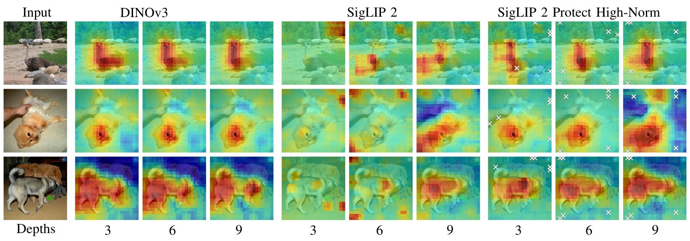
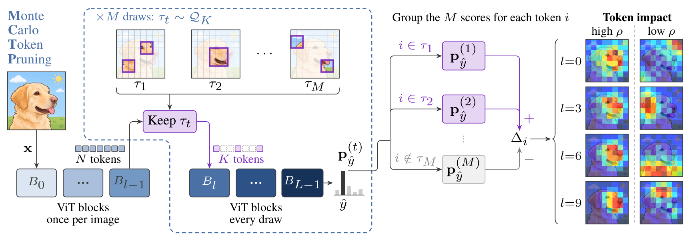
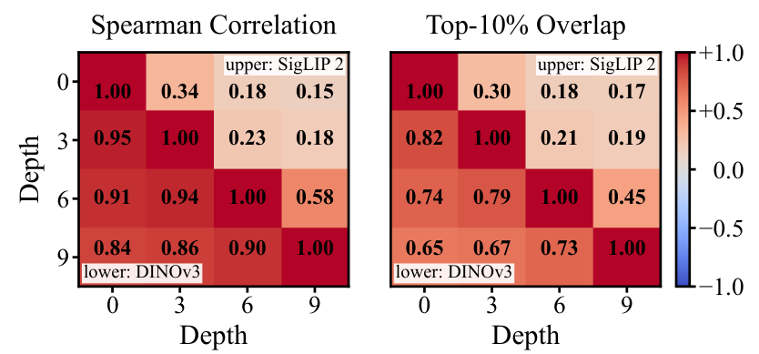

# MCTP: Monte Carlo Token Pruning

MCTP measures how much each patch token of a pretrained Vision Transformer
matters when tokens are removed inside the network.

<p align="center">
  
</p>

*Token-impact maps for DINOv3 and SigLIP 2 B/16 linear probes, pruning once
at block 3, 6 or 9 (selected examples). DINOv3 places its impact on the
object at every depth. SigLIP 2 does not, until its five highest-norm tokens
(white ×) are protected from pruning.*

## Method

<p align="center">
  
</p>

1. **Prune at block l:** a linear-probed ViT is pruned once, at the input of
   block l. Each of M draws keeps about 10% of the patch tokens, as random
   square regions. Prefix tokens ([CLS], registers) are always kept.
2. **Token impact:** for every token, the probability of the unpruned top-1
   class over draws that keep the token is compared with draws that drop it:

   Δᵢ = E[p_ŷ | i kept] − E[p_ŷ | i dropped]

3. **Cached prefix:** blocks 0 … l−1 run once per image, and every draw reuses
   that cached state. A 1,000-draw run at l = 6 therefore costs about as much as
   47 full forward passes.

Over the ImageNet-1k validation set, DINOv3 ranks tokens almost the same way
whichever depth it is pruned at, while SigLIP 2's rankings change with depth:

<p align="center">
  
</p>

*Spearman correlation (left) and top-10% overlap (right) between token-impact
maps at different pruning depths, averaged over the ImageNet-1k validation
set. DINOv3 is below the diagonal and SigLIP 2 above it.*

Built with DINOv3.

## Contents

- **Token-impact maps** at several pruning depths for DINOv3 (S/B/L/16) and
  SigLIP 2 (B/16) linear probes.
- **Sink-token protection:**
  - keep the k highest-norm patch tokens entering block l in every draw;
  - or, as a control, k random tokens per image.
- **Interventions at the point of pruning:**
  - remove DINOv3's prefix tokens;
  - add a test-time register to SigLIP 2 (Jiang et al.), with the neuron
    calibration;
  - an empty-register control.
- **Metrics** (`src/utils/metrics/`):
  - prediction stability;
  - off-box mass against the ImageNet validation boxes;
  - Spearman correlation and top-10% overlap between maps;
  - effective support of the positive impact.

## Setup

```bash
pip install -r requirements.txt
```

The backbone weights download from Hugging Face on first use:
`timm/vit_base_patch16_dinov3.lvd1689m` (DINOv3 License) and
`google/siglip2-base-patch16-384` (Apache 2.0). The linear probes for both
B/16 backbones are in [`probes/`](probes/README.md).

## Quick start

Open [`notebooks/mctp_demo.ipynb`](notebooks/mctp_demo.ipynb) and set
`IMAGE_PATH` to any RGB image. It computes Δ maps at depths 0, 3, 6 and 9 for
three settings, plots them, and prints stability, cross-depth agreement and
effective support:

- DINOv3 B/16;
- SigLIP 2 B/16;
- SigLIP 2 with its five highest-norm tokens protected.

The committed notebook shows its outputs on an ImageNet validation image. It
runs on a laptop CPU in about 3 minutes at M = 1000.

## ImageNet runs

### Data

- **ImageNet-1k validation** in the standard class-folder layout:
  `<imagenet_root>/val/<wnid>/ILSVRC2012_val_XXXXXXXX.JPEG`, with all 1,000
  class folders. Labels follow the sorted folder names.
- **Validation boxes** (only for off-box mass): `ILSVRC2012_bbox_val_v3.tgz`
  or its extracted XML directory.
- **Register calibration** also reads `<imagenet_root>/train/<wnid>/`.

### Configuration

`configs/mctp.yaml` holds every setting with its default. Copy it to
`configs/local.yaml` (gitignored) and set your paths. Settings combine in
order: the YAML files given, then command-line `section.key=value` overrides.

```bash
python src/core/run_mctp.py configs/local.yaml      # maps -> <run.output_dir>/shard000of001.npz
python src/core/score_mctp.py configs/local.yaml    # stability and off-box mass per depth -> summary.json
```

To split a run across jobs, give each one `run.shard=<i> run.num_shards=<n>`.
Score with the same configs once every shard has finished.

### Settings

| Setting | Additional arguments |
| --- | --- |
| DINOv3 B/16 | (defaults) |
| SigLIP 2 B/16 | `model.backbone=siglip2_vitb16 model.probe=probes/siglip2_vitb16.safetensors` |
| Top-5 highest-norm tokens protected | `mctp.protection=top_norm` |
| Five random tokens protected (control) | `mctp.protection=random` |
| SigLIP 2 with a test-time register | `configs/siglip2_test_time_registers.yaml` |
| Empty register (control) | `configs/siglip2_test_time_registers.yaml "mctp.register_neurons=[]"` |
| DINOv3 with its prefix removed at block l | `mctp.intervention=prefix_removed model.probe=<GAP-only probe>` |
| DINOv3 L/16 at matching relative depths | `model.backbone=dinov3_vitl16 "mctp.depths=[0,6,12,18]"` |

- **Calibrated neurons:** `configs/siglip2_test_time_registers.yaml` lists the
  20 neurons the register takes over. To choose them again:
  `python src/core/calibrate_registers.py configs/local.yaml model.backbone=siglip2_vitb16 model.probe=probes/siglip2_vitb16.safetensors`.
  This ranks MLP neurons by their activation at high-norm outlier tokens on 500
  training images, then keeps the count that removes the most outliers.
- **Prefix removal** needs a probe trained on mean-pooled patch tokens only,
  since no [CLS] token reaches the readout.

### Outputs

Each shard is an `.npz` with these arrays:

| Key | Shape | Contents |
| --- | --- | --- |
| `filenames` | [I] | image filenames |
| `labels` | [I] | ground-truth class indices |
| `targets` | [I] | unpruned top-1 predictions |
| `impacts` | [I, D, N] | Δ maps over the 21 × 21 patch grid; NaN where undefined, e.g. protected tokens |
| `protected` | [I, D, N] | protected tokens |
| `stability` | [I, D] | share of draws whose top-1 is still ŷ |
| `depths`, `wnids`, `config` | | the depths, class WNIDs and resolved configuration |

### Precision and cost

- **Precision:** the unpruned prediction and the blocks before l run in
  float32. On CUDA, the pruned draws run under bfloat16 autocast.
- **Batching:** results depend on batching at floating-point noise level.

## Repository layout

```
assets/                  README figures
configs/                 run configurations
notebooks/               demo notebook
probes/                  DINOv3 and SigLIP 2 B/16 linear probes, with their licences
src/
  core/                  entrypoints (run, score, register calibration) and the config schema
  data/                  transforms, ImageNet images and boxes
  models/                frozen backbones, probe files
    token_pruning/       region sampler, prunable classifier, interventions
  trainer/               MCTP replay and token-impact maps, register calibration
  utils/metrics/         token impact, off-box mass, rank agreement, effective support
```

## Licence

- **Code:** MIT; see [`LICENSE`](LICENSE).
- **Probes:** licensed as described in [`probes/README.md`](probes/README.md).
  The DINOv3 probe is under the DINOv3 License and the SigLIP 2 probe under
  Apache 2.0.
